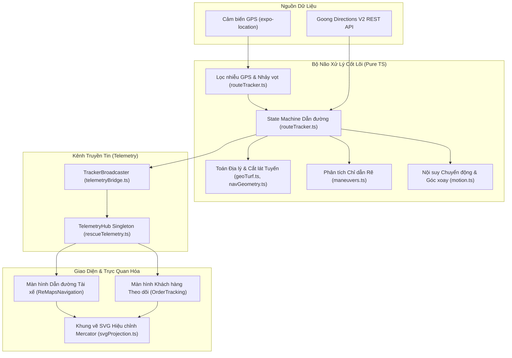

# Tài liệu Kỹ thuật Chi tiết Hệ thống Bản đồ & Dẫn đường ResQ Mobile

Tài liệu này mô tả chi tiết toàn bộ cơ chế hoạt động, kiến trúc phần mềm, luồng xử lý dữ liệu và các kịch bản đối phó sự cố (mất mạng, GPS nhiễu, lạc đường) của phân hệ Bản đồ & Dẫn đường trong ứng dụng **ResQ Mobile** (`resq-mobile`).

---

## 1. Tổng quan Kiến trúc Hệ thống

Hệ thống bản đồ được thiết kế theo mô hình **Tách biệt Trạng thái & Giao diện (State Machine Decoupled from React)**. Toàn bộ logic toán học, tọa độ, bộ lọc tín hiệu được đặt trong các module TypeScript độc lập, không phụ thuộc vào vòng đời của React component.

---

## 2. Chi tiết Các Module Thành phần

### 2.1. Quản lý Tuyến & Bộ não Dẫn đường (`routeTracker.ts`)
Đây là module cốt lõi quan trọng nhất:
- **Kiểu dữ liệu:** Sử dụng mảng tọa độ `[lng, lat]` (kinh độ trước, vĩ độ sau) chuẩn GeoJSON.
- **Tính toán tiến độ:** Khi nhận tín hiệu GPS mới, hệ thống tìm vị trí chiếu vuông góc của xe lên polyline trong một cửa sổ trượt (tránh quét toàn bộ tuyến đường dài gây chậm).
- **Tính ETA & Khoảng cách còn lại:** Dựa trên tỉ lệ chiều dài đoạn đường còn lại so với tổng chiều dài ban đầu, nhân với `durationS` do Goong trả về.
- **Nhận diện đến đích:** Khi khoảng cách từ vị trí xe đến đích $\le 80\text{m}$, kích hoạt trạng thái `arrived = true` và ngừng gọi API.

### 2.2. Tải Tuyến đường & Dự phòng (`goongFetcher.ts`)
- **API thực tế:** Sử dụng Goong Directions V2 (`https://rsapi.goong.io/v2/direction`) với `EXPO_PUBLIC_GOONG_API_KEY`.
- **Giải mã Polyline:** Sử dụng thư viện `@mapbox/polyline` để decode chuỗi overview polyline thành danh sách điểm `[lng, lat]`.
- **Cơ chế Fallback thông minh (`smartFetcher`):**
  - Nếu có key Goong và mạng bình thường: Gọi API thật.
  - Nếu mất mạng, hết quota hoặc lỗi: Ghi nhận log và tự động chuyển sang `createDemoRoute` (tạo tuyến đường dạng lưới ô cờ) để ứng dụng không bao giờ bị dừng hoạt động.

### 2.3. Hướng Xe (Bearing) & Làm mượt Chuyển động (`motion.ts`, `navGeometry.ts`)
- **Tính góc xoay (`bearing`):** Tính toán góc hướng di chuyển giữa 2 điểm liên tiếp (tương đương `turf.bearing`).
- **Lọc rung lắc khi xe dừng:** Khi khoảng cách di chuyển $< 4\text{m}$, góc xoay xe được giữ nguyên, tránh việc icon xe quay cuồng khi dừng đèn đỏ do GPS trôi nhẹ.
- **Xoay theo cung ngắn nhất:** Khi chuyển từ $350^\circ \to 10^\circ$, hệ thống xoay qua mốc $0^\circ$ ($20^\circ$) thay vì quay ngược một vòng lớn $340^\circ$.
- **Nội suy mượt (Lerp):** Icon xe không nhảy cóc giữa các nhịp GPS 1 Hz mà lướt đều giữa tọa độ cũ và tọa độ mới.

### 2.4. Bộ Chỉ dẫn Rẽ Tự động (`maneuvers.ts`)
- Sử dụng cửa sổ trượt $\pm 25\text{m}$ để đo độ lệch góc của các khúc cua.
- **Gom cụm đỉnh (Clustering):** Một khúc cua cong ngoài đời thường được vẽ bởi 8–10 đỉnh tọa độ nhỏ; thuật toán tự gom lại thành **một lần "Rẽ phải" duy nhất**.
- **Phân loại góc:**
  - Lệch $20^\circ - 45^\circ$: Chếch trái / Chếch phải.
  - Lệch $45^\circ - 135^\circ$: Rẽ trái / Rẽ phải.
  - Lệch $> 135^\circ$: Quay đầu xe.
  - Lệch $< 20^\circ$: Tiếp tục đi thẳng.

### 2.5. Phân đoạn Mật độ Giao thông (`traffic.ts`)
- Do Goong Directions V2 chưa trả về dữ liệu tắc đường chi tiết từng đoạn, hệ thống sử dụng module mô phỏng dựa trên:
  - Khung giờ cao điểm ($7:00 - 9:00$ và $16:30 - 19:00$).
  - Các nút giao trọng điểm (ví dụ: Ngã Tư Sở, Cầu Giấy...).
- Polyline được chia thành các đoạn màu:
  - **Xanh lá:** Thông thoáng.
  - **Cam:** Ùn ứ nhẹ.
  - **Đỏ:** Ùn tắc nghiêm trọng (xe mô phỏng sẽ tự động giảm tốc độ khi đi vào vùng này).

### 2.6. Đồng bộ Hai Màn hình (`rescueTelemetry.ts`, `telemetryBridge.ts`)
- **Vai trò:** Trung gian trao đổi dữ liệu giữa màn hình Tài xế cứu hộ ([ReMapsNavigationScreen.tsx](file:///e:/ResQ/resq-mobile/src/screens/remaps/ReMapsNavigationScreen.tsx)) và màn hình Khách hàng ([OrderTrackingScreen.tsx](file:///e:/ResQ/resq-mobile/src/screens/refix/OrderTrackingScreen.tsx)).
- **Cơ chế:**
  - Màn hình Tài xế đóng vai trò Publisher (phát frame GPS gồm: tọa độ, góc quay, tốc độ, cự ly còn lại, ETA).
  - Màn hình Khách hàng đóng vai trò Subscriber: nhận frame và hiển thị xe cứu hộ đang di chuyển trên màn hình của khách.
  - **Khử trùng lặp & Sai thứ tự:** Quản lý bằng số thứ tự `seq`.
  - **Nhận diện mất tín hiệu:** Nếu quá $15\text{s}$ không có frame mới (`staleAfterMs = 15_000`), màn hình Khách hàng tự đổi badge sang màu đỏ báo *"Mất tín hiệu GPS"*.

### 2.7. Trực quan Hóa Bản đồ (`svgProjection.ts` & Lớp Map)
- **Cơ chế vẽ:** Chiếu tọa độ địa lý lên khung vẽ vector `react-native-svg`.
- **Hiệu chỉnh vĩ độ Mercator:** Nhân thêm hệ số $\cos(\text{vĩ độ})$ để khoảng cách $100\text{m}$ theo trục Đông-Tây bằng đúng $100\text{m}$ theo trục Bắc-Nam, khắc phục hiện tượng méo và dẹt hình ở vĩ độ Việt Nam ($21^\circ \text{N}$).

---

## 3. Cơ chế Ứng phó Khi Mất Mạng & Sự Cố Ngoại Lệ

| Sự cố | Cách hệ thống tự động xử lý |
| :--- | :--- |
| **Mất mạng giữa lộ trình** | Giữ nguyên `route` đã tải trong bộ nhớ. GPS của điện thoại vẫn hoạt động ngoại tuyến và xe vẫn di chuyển tiếp bình thường. |
| **Mất mạng khi chưa có tuyến** | Kích hoạt chế độ `fallback`: vẽ đường chim bay nét đứt nối thẳng vị trí hiện tại đến đích để tài xế giữ hướng đi. |
| **Mạng chập chờn khi tính lại tuyến** | Kích hoạt **Exponential Backoff**: thời gian chờ thử lại giãn dần $15\text{s} \to 30\text{s} \to 60\text{s}$, tránh spam kết nối làm kiệt pin và treo mạng. |
| **Lạc đường liên tục (trong bãi ngầm, ngõ cụt)** | **Cầu dao tự ngắt (Circuit Breaker):** Sau 3 lần tự tính lại thất bại (`maxAutoReroutes = 3`), hệ thống ngắt gọi API để bảo vệ tài nguyên. Chỉ kích hoạt lại khi người dùng bấm "Tính lại" hoặc xe di chuyển xa $> 300\text{m}$. |
| **GPS nhảy cóc bất thường (ra khỏi hầm)** | Loại bỏ ngay điểm có sai số lớn ($> 100\text{m}$) hoặc vận tốc nhảy vọt $> 216\text{km/h}$. Cần tối thiểu 4 điểm đo ổn định liên tiếp mới định vị lại xe. |
| **Xe cứu hộ mất kết nối mạng** | Sau $15\text{s}$ không nhận được gói tin, màn hình Khách hàng cảnh báo màu đỏ *"Mất tín hiệu GPS · Xs"* để khách biết tình trạng. |

---

## 4. Những Điểm Còn Hạn Chế Hiện Tại

> [!WARNING]
> Những điểm dưới đây là lý do hệ thống hiện tại **mới chỉ ở mức thử nghiệm (prototype/testbench)**, chưa thể chạy ngoài đường thực tế:

1. **Chưa có gạch nền bản đồ thật (Map Tiles):**
   - Đang vẽ bằng SVG thuần trên nền xám/tối, không có tên đường, ngõ hẹp, tòa nhà hay sông hồ thật của Goong Map.
2. **Chưa chạy được trên 2 thiết bị độc lập:**
   - Kênh `rescueTelemetry` mới chỉ là Singleton trong RAM của 1 chiếc điện thoại. Nếu mở ở 2 máy khác nhau ngoài đường thì 2 máy chưa thể giao tiếp với nhau.
3. **Chưa lưu trạng thái bền vững (Offline Persistence):**
   - Toàn bộ tuyến đường và trạng thái nằm trong RAM. Nếu tắt app hoặc app bị hệ điều hành đóng lại khi mất mạng thì mở lên sẽ mất toàn bộ lộ trình.
4. **Chưa có chức năng Tọa độ GPS & SMS khẩn cấp:**
   - Chưa hiển thị số vĩ độ/kinh độ thật để đọc khi gọi điện thoại cấp cứu.
   - Các nút "Đã gửi SMS" chỉ là giao diện tĩnh, chưa kết nối đến ứng dụng nhắn tin của máy.

---

## 5. Hướng Nâng Cấp Sản Phẩm (Production Roadmap)

1. **Nhúng Goong Map thật:** Sử dụng `react-native-webview` nạp Vector Tiles Goong (`https://tiles.goong.io/assets/goong_map_web.json?api_key=...`) để hiển thị toàn bộ bản đồ Việt Nam.
2. **Cài đặt Realtime Network Transport:** Triển khai WebSocket Server / Supabase / Firebase Realtime cắm vào `TelemetryTransport` để 2 điện thoại thật đồng bộ tọa độ qua Internet.
3. **Lưu ngoại tuyến với `AsyncStorage`:** Lưu lộ trình hiện tại vào bộ nhớ máy để khôi phục khi mất mạng.
4. **Bổ sung Tọa độ & SMS Khẩn cấp ngoại tuyến:** Lấy tọa độ GPS thật in lên màn hình (kèm nút Copy) và tích hợp `Linking.openURL('sms:...?body=...')` để gửi tin nhắn khẩn cấp khi mất sóng 4G.
