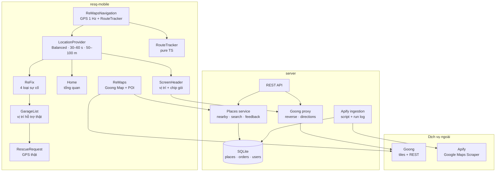
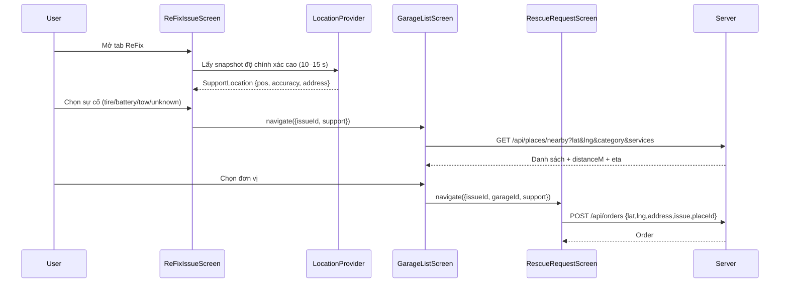

# ResQ — Kế hoạch cải tổng thể (Home / Hội viên / ReFix / ReMaps / GPS / Apify)

> **Trạng thái:** BẢN NHÁP — chờ duyệt trước khi sửa code  
> **Ngày:** 21/11/2026  
> **Phạm vi:** `resq-mobile` (Expo/React Native) + `server` (Node HTTP + SQLite + WebSocket)  
> **Không nằm trong phạm vi:** thêm AI chat, mở app dẫn đường bên ngoài, thanh toán thật, GPS nền chạy 24/7.

---

## 0. Tóm tắt điều hành

Bảy vấn đề được xử lý theo cùng một nguyên tắc: **mỗi thứ chỉ có một nguồn sự thật**.

| # | Vấn đề | Quyết định đề xuất |
|---|---|---|
| 1 | Hai nút “Hội viên” / “Khám phá” trùng nhau | Bỏ mode switcher; Home còn một hero “Xe của bạn”. Gói hội viên chuyển thành màn `Membership` trong Tài khoản, hiển thị chip gói ở header. |
| 2 | Header luôn hiện “R6 Vincom Royal City” | Đưa GPS thật lên header qua `LocationProvider` dùng chung; ưu tiên last-known + reverse geocode có cache. Không còn chuỗi R6 hard-code. |
| 3 | Home vừa là dashboard vừa là entry ReFix | Home chỉ còn tổng quan (xe, gói, đơn đang xử lý, bản đồ, an toàn). ReFix là entry duy nhất cho 4 loại sự cố, có deep link `resq://refix?issue=...`. |
| 4 | ReMaps dùng SVG giả + dữ liệu mock | Thay bằng Goong Map thật + vị trí hiện tại + POI thật từ backend. Chỉ mount map khi mở ReMaps; Home không tải map để tiết kiệm quota. |
| 5 | Chưa có dữ liệu gara/trạm xăng/sạc/bãi đỗ | Pipeline Apify → chuẩn hoá → SQLite `places` → API `/api/places/nearby`. Apify chạy ở server, không chạy từ app. |
| 6 | ReFix cả 4 loại sự cố dùng vị trí cố định | Truyền `SupportLocation` thật xuyên suốt ReFix → GarageList → RescueRequest; khoảng cách/ETA tính từ vị trí đó. |
| 7 | Chưa có chính sách tần suất GPS | 1 Hz chỉ khi dẫn đường; 30–60 giây/50–100 m cho header; snapshot độ chính xác cao khi vào ReFix; GPS nền để giai đoạn sau. |

**Nguyên tắc kỹ thuật:**

- `RouteTracker` vẫn là pure TypeScript, Turf nằm sau interface `Geo`; test không cần React Native.
- Goong REST key **chỉ** nằm ở server. App chỉ nhận map key (tiles/style).
- Không hard-code key, không hard-code vị trí, không hard-code danh sách gara trong UI.
- API là hợp đồng chung; mobile không đọc trực tiếp DB hay Apify.

---

## 1. Hiện trạng — các điểm đã xác nhận trong code

### 1.1. Home và Hội viên

| Vị trí | Hiện trạng | Hệ quả |
|---|---|---|
| `resq-mobile/src/screens/home/HomeScreen.tsx:24` | `homeMode: 'member' | 'explore'` | Tạo hai bản Home gần như song song. |
| `HomeScreen.tsx:38–76` | Mode switcher “Hội viên / Khám phá” | Hai nút cùng cấp, cùng đích đến, gây trùng lặp. |
| `HomeScreen.tsx:91–97` | Pill “Premium” → `navigateToTab('ReSosTab')` | Không mở chi tiết gói; chỉ nhảy sang tab ReSOS. |
| `HomeScreen.tsx:135–141` | CTA “Xem gói từ 9.000đ/tháng” → `ReSosTab` | Cùng một đích đến lần thứ hai. |
| `resq-mobile/src/screens/resos/ReSosPlansScreen.tsx` | Toàn bộ bảng gói `SUBSCRIPTION_PLANS` nằm trong tab ReSOS | Gói hội viên bị đặt sai chỗ; tab ReSOS vừa là SOS vừa là bảng giá. |
| `resq-mobile/src/screens/settings/SettingsScreen.tsx:90–92` | Chỉ hiện text “Gói {activePlan}” | Không bấm được, không có nơi quản lý gói. |
| `resq-mobile/src/components/ScreenHeader.tsx:103` | `USER_PROFILE.locationShort` | Header luôn là R6. |

### 1.2. Vị trí và GPS

| Vị trí | Hiện trạng |
|---|---|
| `HomeScreen.tsx:239` | `USER_PROFILE.locationShort`, thêm cứng “Thanh Xuân”. |
| `HomeScreen.tsx:256–266` | Mini-map là SVG vẽ tay, không phải bản đồ thật. |
| `resq-mobile/src/screens/refix/ReFixIssueScreen.tsx:60–77` | Vị trí cần hỗ trợ là R6; nút “Định vị” chỉ bật `Alert`, không gọi GPS. |
| `resq-mobile/src/screens/refix/GarageListScreen.tsx:58–60` | Chip vị trí là R6; danh sách lấy từ `GARAGES_DATA`, khoảng cách cố định. |
| `resq-mobile/src/screens/remaps/ReMapsSearchScreen.tsx:93–111` | “Bản đồ” là SVG; danh sách là `NEARBY_PLACES` mock. |
| `resq-mobile/src/features/location/useDeviceLocation.ts` | Đã có GPS thật, nhưng mặc định `High`, 1 giây, 2 m cho mọi caller. |
| `resq-mobile/src/screens/refix/RescueRequestScreen.tsx:50` | Đã dùng GPS thật (2 giây/3 m) — đây là màn duy nhất của ReFix dùng vị trí thật. |
| `resq-mobile/src/screens/remaps/ReMapsNavigationScreen.tsx:65–72` | Đã dùng GPS thật 1 Hz khi dẫn đường. |

### 1.3. Home trùng vai trò ReFix

- `HomeScreen.tsx:145–158`: mục “Hỗ trợ nhanh” + link “Tất cả sự cố” → `ReFixTab`.
- `HomeScreen.tsx:160–224`: 4 thẻ `Hỏng lốp`, `Kích bình`, `Kéo xe`, `Phạt nguội`; ba thẻ đầu đi thẳng `GarageList`, bỏ qua bước chọn sự cố của ReFix.
- `HomeScreen.tsx:316–336`: thẻ “Đơn đang xử lý #RQ-8924” là dữ liệu mock, không đọc đơn thật.
- `resq-mobile/src/navigation/AppNavigator.tsx:70–79`: tab ReFix tồn tại, nhưng Home đang mở một đường vào thứ hai.

### 1.4. Backend hiện có

- `server/src/http.ts:91–105`: đã có proxy `/api/geo/reverse` và `/api/geo/directions`; REST key không xuống app.
- `server/src/goong.ts:30`: reverse cache 24 giờ theo lưới `lat.toFixed(4)` (~11 m).
- `server/src/goong.ts:48–54`: directions gọi `/v2/direction`, có whitelist `vehicle` (`bike` là xe đạp — không dùng cho xe máy).
- `server/src/db.ts`: có `users`, `orders`, `order_events`, `staff_presence`, `track_points`; **chưa có bảng `places`**.
- `server/src/http.ts:89`: `/api/config` trả `goongMapKey` và `geocoding`.
- `server/src/http.ts:35`: server chấp nhận 8 loại sự cố (`tire`, `battery`, `tow`, `fuel`, `lockout`, `accident`, `engine`, `unknown`), trong khi mobile chỉ có 4 (`tire`, `battery`, `tow`, `unknown`). Cần map rõ 4 → 8.

### 1.5. Cấu hình và bảo mật

- `resq-mobile/.env` đang chứa cả `EXPO_PUBLIC_GOONG_API_KEY` (REST) lẫn `EXPO_PUBLIC_GOONG_MAP_KEY` (tiles). REST key không nên có trong bundle app.
- `server/src/env.ts:17` đọc `resq-mobile/.env` trước `server/.env`; tiện cho demo nhưng dễ làm lẫn key.
- `resq-mobile/app.json` đã có plugin `expo-location` và quyền foreground; chưa có quyền background (đúng với phạm vi v1).
- `resq-mobile/src/config.ts:88–90`: map key và `MAP_BASE_URL` lấy từ `EXPO_PUBLIC_*`.

> **Ghi chú drift:** kế hoạch trước ghi nhận AI chat đã bị bỏ, nhưng mã hiện tại vẫn còn `QBinAssistantScreen`, entry “Hỏi Trợ lý AI Q-Bin” ở Home và “Trợ lý AI ResQ (Q-Bin)” ở Settings. Đây là việc dọn dẹp riêng, không thuộc 7 mục lần này; nếu anh Minh xác nhận đã bỏ AI thì nên xử lý trong một PR riêng để tránh trộn phạm vi.

---

## 2. Kiến trúc mục tiêu



**Luồng dữ liệu chính:**

1. GPS → `LocationProvider` → header/Home/ReFix.
2. ReFix chốt `SupportLocation` → `GarageList` → `RescueRequest` → `POST /api/orders`.
3. Apify → chuẩn hoá → `places` → `GET /api/places/nearby` → ReMaps/ReFix.
4. Goong REST chỉ đi qua server; app chỉ tải tiles bằng map key.

---

## 3. Giải pháp chi tiết

### 3.1. Gộp “Hội viên / Khám phá”, đưa gói vào Tài khoản và header

#### Thiết kế UI mới

**Home (một bản duy nhất):**

```text
┌──────────────────────────────────────────────┐
│ ResQ        [📍 Vị trí hiện tại]  [Premium] │  ← header
├──────────────────────────────────────────────┤
│  Xe của bạn                                  │
│  Toyota Camry 2023 · 30H-123.45              │
│  Gói Premium · còn 28 ngày        [Quản lý] │
├──────────────────────────────────────────────┤
│  Đơn đang xử lý (nếu có)                     │
│  RQ-XXXX · Đang đến · 7 phút                 │
├──────────────────────────────────────────────┤
│  [Bản đồ & địa điểm]   [An toàn & SOS]      │
└──────────────────────────────────────────────┘
```

- Bỏ `homeMode`, bỏ mode switcher, bỏ hero “Khám phá”.
- Hero “Khám phá” cũ có nội dung va chạm/Map4D → chuyển ý “An toàn & SOS” sang tab An toàn; không giữ bản sao ở Home.
- Home **không** còn 4 thẻ sự cố. Chỉ còn:
  - Hero xe + gói.
  - Card đơn đang xử lý (đọc `ordersApi.active()`).
  - Hai lối tắt không trùng ReFix: `ReMaps`, `An toàn`.
  - (Tuỳ chọn) card “Phạt nguội” nếu tính năng này được giữ; nếu chưa có backend thì bỏ để tránh mock.

**Header:**

- `ScreenHeader` nhận thêm `membership?: { label: string; daysLeft: number; onPress: () => void }`.
- Chip gói đặt cạnh pill vị trí, ví dụ `Premium · 28 ngày`; bấm → `Membership`.
- Nếu chưa có gói: chip `Gói Free` hoặc `Nâng cấp`.
- Stack header (các màn con) giữ tiêu đề; không nhồi chip gói để tránh rối. Chỉ brand header của Home/Settings hiển thị chip.

**Settings:**

- Profile card thêm dòng bấm được: `Gói hội viên` → `Membership`.
- Bỏ text tĩnh `Gói {activePlan}` hoặc đổi thành badge + chevron.
- Thêm mục `Quyền riêng tư vị trí` (tuỳ chọn) để giải thích GPS.

**Membership screen:**

- Tạo `src/screens/membership/MembershipScreen.tsx`.
- Chuyển nguyên nội dung `ReSosPlansScreen` (3 gói, chu kỳ tháng/năm, CTA) sang.
- `RootStackParamList` thêm `Membership: undefined`.
- `AppNavigator` thêm `Stack.Screen name="Membership"`.
- `ReSosPlansScreen` không còn là tab screen; thay bằng `SafetyHubScreen` (xem 3.3).

**Dữ liệu gói:**

- Giai đoạn demo: tách `SUBSCRIPTION_PLANS` và `USER_PROFILE.activePlan` sang `src/data/membership.ts`; `MembershipContext` cung cấp `plan`, `daysLeft`, `isPremium`.
- Giai đoạn production: thêm `GET /api/me/membership`; bảng `memberships` (xem §4.4). Không cần payment trong đợt này.

#### Việc cần làm

1. Xoá `homeMode`, `HomeMode` khỏi `HomeScreen` và `types` nếu không còn dùng.
2. Tạo `MembershipScreen`; chuyển logic chọn gói.
3. Thêm route `Membership` + deep link.
4. `SettingsScreen` thêm row gói.
5. `ScreenHeader` thêm prop chip gói; Home truyền dữ liệu.
6. Xoá text/CTA trùng lặp ở Home.
7. Kiểm tra `ReSosPlansScreen` còn được import ở đâu; nếu chỉ còn tab ReSOS thì thay bằng màn An toàn.

#### Tiêu chí nghiệm thu

- Home chỉ còn một hero, không còn nút “Hội viên/Khám phá”.
- Bấm chip gói ở header hoặc row trong Settings đều mở `Membership`.
- Không còn đường nào từ Home mở thẳng `GarageList`.
- `grep -r "homeMode"` không còn kết quả trong UI.

---

### 3.2. Vị trí GPS thật trên header (bỏ R6)

#### Kiến trúc

Tạo `src/features/location/LocationProvider.tsx`:

```ts
interface LocationState {
  status: 'idle' | 'checking' | 'ready' | 'denied' | 'blocked' | 'services-off' | 'error';
  fix: Fix | null;             // { pos, accuracyM, heading, speedMps, ts }
  place: CurrentPlace | null;   // { shortLabel, address, compound }
  source: 'last-known' | 'gps' | 'manual' | null;
  updatedAt: number | null;
  request: () => Promise<void>; // xin quyền + lấy vị trí
  refresh: () => Promise<void>;
}
```

- Mount trong `App.tsx`, bên trong `AuthProvider`, ngoài `AppNavigator`.
- Không xin quyền ngay khi mở app. Home hiển thị một banner nhỏ:
  - “Bật định vị để ResQ tìm gara gần bạn” → `request()`.
  - “Để sau” → header hiện `Chưa có vị trí`.
- Khi đã có quyền:
  1. `getLastKnownPositionAsync({ maxAge: 60_000 })` → hiện ngay (thường <300 ms).
  2. `getCurrentPositionAsync({ accuracy: Balanced })` → cập nhật.
  3. `watchPositionAsync({ accuracy: Balanced, timeInterval: 30_000, distanceInterval: 50 })` → cập nhật nền foreground.
- Khi app vào background: remove subscription; khi active lại: lấy last-known rồi refresh.

#### Reverse geocode và nhãn ngắn

- Gọi `geoApi.reverse(lat, lng)` qua server; server đã cache 24 giờ theo lưới ~11 m.
- Client cache thêm:
  - Key: geohash precision 6 (~1,2 km) hoặc `lat.toFixed(3),lng.toFixed(3)` (~110 m).
  - TTL: 30 phút.
  - Lưu `AsyncStorage` để mở app có nhãn cũ ngay.
- Ưu tiên nhãn:
  1. `place.name` nếu không phải “Unnamed Road”.
  2. `compound.ward` + `compound.district` (ví dụ “Thanh Xuân, Hà Nội”).
  3. 2–3 đoạn đầu của `formatted_address`.
  4. Toạ độ rút gọn `21.0285, 105.8542`.
- Cắt tối đa ~28 ký tự; header dùng `numberOfLines={1}`.
- Không hiển thị “R6 Vincom Royal City” nếu GPS đang ở nơi khác.

#### Trạng thái header

| Trạng thái | Hiển thị | Hành động |
|---|---|---|
| `idle` | `Bật định vị` | `request()` |
| `checking` | `Đang định vị…` + spinner nhỏ | none |
| `ready` | Nhãn ngắn + icon location | mở ReMaps |
| `ready` nhưng accuracy > 100 m | Nhãn + `±m` hoặc “Vị trí tương đối” | `refresh()` |
| `denied` | `Cần quyền vị trí` | mở Settings / hỏi lại |
| `blocked` | `Mở Cài đặt` | `Linking.openSettings()` |
| `services-off` | `GPS đang tắt` | mở Settings |
| `error` | `Không đọc được GPS` | thử lại |

#### Thay thế hard-code

- `ScreenHeader.tsx`: bỏ import `USER_PROFILE`; dùng `useLocation().place?.shortLabel`.
- `HomeScreen.tsx`: bỏ `USER_PROFILE.locationShort`; mini-map card dùng cùng nhãn.
- `ReFixIssueScreen.tsx`: dùng `SupportLocationCard` (xem 3.6).
- `GarageListScreen.tsx`: nhận `support` từ route hoặc context.
- `ReMapsSearchScreen.tsx`: dùng `fix.pos` và nhãn thật.
- `mockData.ts`: xoá `locationShort`/`locationFull` khỏi `USER_PROFILE` hoặc để `null`; không dùng trong UI.

#### Tiêu chí nghiệm thu

- Cấp quyền xong, header đổi khỏi R6 trong ≤ 2 giây (last-known) và ≤ 10 giây (GPS mới).
- Tắt GPS → header hiện `GPS đang tắt`, không hiện vị trí cũ như thật.
- Không còn chuỗi `R6 Vincom` trong `src/` (trừ test/fixture).
- Xoay màn hình / mở lại app vẫn giữ nhãn cache, sau đó cập nhật.

---

### 3.3. Tách Home khỏi vai trò entry ReFix

#### Cấu trúc điều hướng mới

```text
Bottom tabs
├── Tổng quan (Home)          — dashboard, không chọn sự cố
├── ReFix                     — entry DUY NHẤT cho 4 loại sự cố
├── SOS (nút giữa)            — mở SosHoldModal, không phải màn chọn sự cố
├── ReMaps                    — bản đồ + POI
└── Tài khoản (Settings)      — hồ sơ, gói, cài đặt

Stack con
ReFix → GarageList → RescueRequest → OrderTracking → Rating
Settings → Membership
Settings → EmergencyContacts
Settings → SafetyHub (hoặc tab An toàn)
```

**Quyết định về tab ReSOS hiện tại:**

- Tab giữa đang là `ReSosTab` + `ReSosPlansScreen`; bấm nút SOS mở modal, bấm label mở bảng gói. Sau khi chuyển gói sang Membership, tab này không còn lý do tồn tại dưới dạng bảng giá.
- Đề xuất: đổi tab thành **An toàn** (`SafetyHubScreen`), gồm:
  - Nút giữ SOS 3 giây (dùng `openSosModal`).
  - Phát hiện va chạm (`CrashDetection`).
  - Người liên hệ khẩn cấp.
  - Card tóm tắt gói + link `Membership`.
- Nếu muốn giữ tên ReSOS: tab vẫn là “An toàn”, label phụ “ReSOS”; không thay đổi nút SOS nổi.

#### Entry ReFix

- Tab ReFix là entry chính.
- Deep link: `resq://refix?issue=tire|battery|tow|unknown`.
- `ReFixIssueScreen` nhận `route.params?.issueId` để preselect khi mở từ notification/deep link.
- Không còn `HomeScreen` gọi `navigation.navigate('GarageList', ...)`.
- Nếu cần một CTA khẩn cấp trên Home, chỉ dùng SOS (đã có nút giữa), không tạo thêm flow chọn sự cố.

#### Home card “Đơn đang xử lý”

- Gọi `ordersApi.active()` khi Home focus.
- Có đơn → card trạng thái thật + bấm mở `OrderTracking({ orderId })`.
- Không có → ẩn card hoặc hiện “Không có yêu cầu đang xử lý”.
- Xoá `USER_PROFILE.orderId` khỏi UI.

#### Tiêu chí nghiệm thu

- Từ Home không thể vào `GarageList` trực tiếp.
- Bấm tab ReFix → chọn 1 trong 4 sự cố → `GarageList`.
- Deep link mở đúng sự cố được chọn.
- Home không còn 4 thẻ trùng ReFix.

---

### 3.4. ReMaps: bản đồ thật + tối ưu quota Goong

#### 3.4.1. Thay mock bằng map thật

`ReMapsSearchScreen` mới:

```text
┌──────────────────────────────────────────────┐
│ ReMaps · Quanh đây                           │
│ [🔍 Tìm gara, trạm xăng, trạm sạc...]        │
│ [Gara] [Trạm xăng] [Trạm sạc] [Bãi đỗ]      │
├──────────────────────────────────────────────┤
│                                              │
│        Goong Map (WebView)                   │
│        • vị trí hiện tại (blue dot)          │
│        • POI markers theo category           │
│        • vòng sai số GPS                     │
│                                              │
├──────────────────────────────────────────────┤
│ Gara gần bạn (12)                            │
│ ...danh sách từ /api/places/nearby...        │
└──────────────────────────────────────────────┘
```

- Dùng `GoongMapView` (đã có) thay SVG.
- Map mode `overview`; center theo `fix.pos`; zoom 15–16.
- Không tự chạy `fitBounds` toàn thành phố; chỉ fit POI trong bán kính 3–5 km.
- Khi bấm marker → highlight card tương ứng; khi bấm card → `select` marker + `easeTo`.
- Nút “Đi” → `ReMapsNavigation` với `destCoords` thật.

#### 3.4.2. Mở rộng giao thức map

`goongMapHtml.ts` hiện hỗ trợ `route`, `progress`, `vehicle`, `dest`, `fallback`, `mode`. Bổ sung:

```ts
// RN → Web
{ type: 'me', pos: [lng, lat], accuracyM: number | null, heading: number | null }
{ type: 'pois', items: Array<{ id: string; pos: [lng, lat]; cat: 'garage'|'fuel'|'charging'|'parking'; label: string }> }
{ type: 'selectPoi', id: string | null }
{ type: 'fitPois', padding?: number }

// Web → RN
{ type: 'poiPress', id: string }
{ type: 'mapIdle', center: [lng, lat], zoom: number }
```

- `me`: blue dot + accuracy circle (dùng `circle()` đã có).
- `pois`: `goongjs.Marker` với màu theo category; không dùng ảnh remote.
- `selectPoi`: đổi marker thành trạng thái selected + callout nhỏ.
- `fitPois`: `fitBounds` có padding, `maxZoom: 16`.

`GoongMapView` thêm props:

```ts
interface GoongMapViewProps {
  // ...props hiện có
  me?: { pos: LngLat; accuracyM: number | null; heading: number | null } | null;
  pois?: MapPoi[];
  selectedPoiId?: string | null;
  onPoiPress?: (id: string) => void;
  onMapIdle?: (center: LngLat, zoom: number) => void;
}
```

#### 3.4.3. Chính sách tiết kiệm quota

| Tác vụ Goong | Khi nào gọi | Cache | Giới hạn |
|---|---|---|---|
| Map load / tiles | Chỉ khi mở ReMaps hoặc Navigation | WebView HTTP cache; không remount | 1 map/session; không đặt map ở Home |
| Reverse geocode | Header/ReFix khi có fix mới | Server 24 h; client 30 phút; lưới 100 m | Chỉ khi di chuyển >100 m hoặc >5 phút |
| Directions | Khi chọn đích / reroute | Server 5–15 phút theo geohash + dest + vehicle; `RouteTracker` cooldown 15 s → 60 s | 1 request/đích; không gọi khi đang browse |
| Distance Matrix | Chỉ top 3–10 ứng viên khi cần ETA thật | Server 5 phút | Không dùng cho list POI |
| Autocomplete | Khi user gõ, ≥3 ký tự | Server 24 h | Debounce 300 ms; tối đa 5 request/phút/user |
| Static Map | (Tuỳ chọn) Home snapshot | Server 10 phút | Chỉ 1 ảnh/phiên; nếu quota thấp thì bỏ |

**Khuyến nghị cho Home:** không dùng Goong Map/Static Map ở v1. Home hiển thị card “Vị trí hiện tại” + nút “Mở ReMaps”; đây là cách tiết kiệm nhất và tránh map load lặp lại mỗi lần mở app. Nếu cần ảnh minh hoạ, dùng snapshot tĩnh có cache và chỉ tải khi Home focus lần đầu trong 24 giờ.

**Quản lý key:**

- `EXPO_PUBLIC_GOONG_MAP_KEY`: chỉ dùng cho tiles/style; giới hạn theo bundle ID / referer trên dashboard Goong.
- `GOONG_API_KEY` (REST): chỉ trong `server/.env`; không có trong mobile `.env`.
- `/api/config` trả map key (đã có); app không cần `EXPO_PUBLIC_GOONG_MAP_KEY` nếu đã đăng nhập.
- Demo key phải đặt quota/thời hạn và thu hồi sau demo.

**Chống lạm dụng:**

- Server đếm số request Goong theo user/ngày; trả `429 quota_exceeded` kèm thông báo thân thiện.
- Admin xem `goong_usage` (số request theo endpoint/ngày).
- Nếu Goong lỗi 429: map vẫn hiển thị tiles cache; directions fallback đường chim bay (`fallback` đã có trong tracker); không crash.

#### 3.4.4. Dữ liệu POI

- Nguồn: `GET /api/places/nearby` (xem §4.2), không gọi Goong Place Search hàng loạt.
- Chỉ tải POI trong viewport/bán kính hiện tại, tối đa 50 marker.
- Debounce `mapIdle` 500 ms; huỷ request cũ khi pan/zoom tiếp.
- Nếu backend chưa có dữ liệu: hiện empty state “Chưa có dữ liệu quanh đây” + nút thử lại; không quay lại mock.

#### Tiêu chí nghiệm thu

- Không còn `Svg` map trong `ReMapsSearchScreen`.
- Map hiển thị đúng vị trí hiện tại, không phải R6.
- POI lấy từ API thật; bấm marker mở đúng card.
- Chuyển tab qua lại không làm map load lại.
- Số request Goong trong một phiên browse ≤ 3 (không tính tiles).

---

### 3.5. Pipeline Apify: thu thập gara, trạm xăng, trạm sạc, bãi đỗ Hà Nội

#### 3.5.1. Nguyên tắc

- Apify chạy ở **server**, không chạy từ app.
- Chỉ lưu dữ liệu doanh nghiệp công khai; không lưu review/người dùng.
- Mỗi lần chạy có log, chi phí ước tính, dataset ID; có thể chạy lại.
- Dữ liệu Apify chỉ là nguồn thô; UI đọc từ DB đã chuẩn hoá.

#### 3.5.2. Actor và input

Actor: `compass/crawler-google-places` (Google Maps Scraper), giá từ ~$1,50/1.000 địa điểm.

Input mẫu:

```json
{
  "searchStringsArray": [
    "gara ô tô",
    "trung tâm sửa chữa ô tô",
    "thay lốp ô tô",
    "cứu hộ giao thông",
    "trạm xăng",
    "trạm sạc xe điện",
    "bãi đỗ xe"
  ],
  "customGeolocation": {
    "type": "Polygon",
    "coordinates": [[
      [105.65, 20.90],
      [105.98, 20.90],
      [105.98, 21.22],
      [105.65, 21.22],
      [105.65, 20.90]
    ]]
  },
  "maxCrawledPlacesPerSearch": 150,
  "language": "vi",
  "skipClosedPlaces": true,
  "scrapePlaceDetailPage": false,
  "maxReviews": 0,
  "maxImages": 0,
  "scrapeContacts": false
}
```

**Lưu ý chi phí:** 7 từ khoá × 150 = tối đa 1.050 địa điểm → khoảng **$1,60**. Nếu chạy full Hà Nội với 300/lượt, chi phí ~$3–5. Cần chốt ngân sách trước khi chạy trả phí.

**Toạ độ:** GeoJSON dùng thứ tự `[lng, lat]`; polygon trên bao vùng nội thành + vành đai. Có thể chia 2 vùng (nội thành và ngoại thành) rồi dedupe nếu cần phủ rộng hơn.

**Từ khoá theo nhóm:**

| Nhóm | Từ khoá |
|---|---|
| Gara/sửa chữa | `gara ô tô`, `trung tâm sửa chữa ô tô`, `sửa chữa ô tô`, `bảo dưỡng ô tô`, `đồng sơn ô tô` |
| Lốp | `thay lốp ô tô`, `vá lốp ô tô`, `tiệm lốp` |
| Cứu hộ/kéo xe | `cứu hộ giao thông`, `kéo xe`, `xe cẩu` |
| Trạm xăng | `trạm xăng`, `cây xăng`, `petrolimex` |
| Trạm sạc | `trạm sạc xe điện`, `trạm sạc vinfast`, `EV charging` |
| Bãi đỗ | `bãi đỗ xe`, `bãi giữ xe`, `gửi xe ô tô` |

#### 3.5.3. Script ingestion

Tạo `server/scripts/ingest-places.ts`:

```text
1. Đọc APIFY_TOKEN, APIFY_ACTOR_ID từ server/.env
2. POST /v2/acts/{actor}/runs?token=...  (input JSON)
3. Poll GET /v2/actor-runs/{runId} đến SUCCEEDED/FAILED
4. GET /v2/datasets/{datasetId}/items?clean=true&format=json
5. Chuẩn hoá từng item → PlaceInput
6. Lọc:
   - có name + lat/lng
   - trong polygon Hà Nội
   - không permanentlyClosed / temporarilyClosed
   - category map được
7. Upsert vào SQLite (transaction, batch 200)
8. Ghi place_import_runs: runId, datasetId, input, stats, cost ước tính
```

Không cần SDK: Node 22+ có `fetch`. Nếu muốn retry/backoff tốt hơn, dùng `apify-client`.

**Chuẩn hoá trường:**

| Apify | DB |
|---|---|
| `placeId` | `source_id` |
| `title` | `name` |
| `categoryName` + `categories` | `subcategories` (JSON), `category` (map) |
| `address` | `address` |
| `location.lat/lng` | `lat`, `lng` |
| `phone` / `phoneUnformatted` | `phone` |
| `website` | `website` |
| `totalScore` | `rating` |
| `reviewsCount` | `reviews_count` |
| `openingHours` | `opening_hours` (JSON) |
| `price` | `price_level` |
| `permanentlyClosed` / `temporarilyClosed` | `business_status` |
| `url` | `source_url` |
| `scrapedAt` | `last_seen_at` |

**Map category:**

```ts
function classify(item): 'garage' | 'fuel' | 'charging' | 'parking' | 'other' {
  const s = `${item.categoryName} ${item.categories?.join(' ')} ${item.title}`.toLowerCase();
  if (/trạm sạc|sạc xe|charging|ev charger|vinfast/.test(s)) return 'charging';
  if (/trạm xăng|cây xăng|petrol|gas station|fuel/.test(s)) return 'fuel';
  if (/bãi đỗ|bãi giữ|gửi xe|parking/.test(s)) return 'parking';
  if (/gara|sửa chữa|ô tô|auto|car repair|tire|lốp|towing|cứu hộ|kéo xe|bảo dưỡng/.test(s)) return 'garage';
  return 'other';
}
```

**Service tags** (để lọc 4 loại sự cố):

- Suy ra từ tên/category: `tire`, `battery`, `tow`, `diagnostics`, `fuel`, `charging`, `parking`.
- Gara đối tác nhập tay trong admin có `services` chính xác hơn.
- Nếu không có tag, garage vẫn hiện cho `unknown`/`tire`/`battery` với nhãn “cần xác nhận dịch vụ”.

#### 3.5.4. Chống trùng và cập nhật

- Khoá chính: `source + source_id` (Google `placeId`).
- Nếu không có `placeId`: hash `normalize(name) + round(lat,5) + round(lng,5)`.
- Kiểm tra trùng mềm: cùng số điện thoại (chỉ chữ số) hoặc tên giống ≥ 0,9 + cách < 50 m → gộp, giữ bản ghi mới nhất.
- Khi upsert: chỉ ghi đè trường có giá trị; không xoá dữ liệu tốt bằng `null`.
- Đánh dấu `hidden=1` cho bản ghi trùng/bị báo sai; không xoá cứng.
- `last_seen_at` mỗi lần crawl; UI hiển thị “Cập nhật ...”. Không tự ẩn nếu quá 90 ngày, chỉ gắn nhãn “Dữ liệu cũ”.

**Tần suất:**

| Loại | Tần suất | Ghi chú |
|---|---|---|
| Full crawl Hà Nội | 1 lần đầu + mỗi 30 ngày | Chạy đêm, có log chi phí |
| Refresh top gara đối tác | 7–14 ngày | Ưu tiên rating/giờ mở cửa |
| On-demand | Khi user báo sai | 1 place/lần, kiểm soát chi phí |
| Trạm xăng/sạc/bãi đỗ | 30–90 ngày | Ít thay đổi |

#### 3.5.5. Dữ liệu đối tác nhập tay

- Seed 4 gara hiện có trong `mockData.ts` thành `places` với `source='manual'`, `verified=1`, toạ độ thật.
- Admin có thể sửa `services`, `phone`, `priority`, `hidden`.
- Đây là lớp “chất lượng cao” để demo không phụ thuộc hoàn toàn vào Apify.

#### 3.5.6. Pháp lý và an toàn

- Chỉ thu thập dữ liệu doanh nghiệp công khai (tên, địa chỉ, SĐT, website, giờ mở cửa).
- Không thu thập review, tên người đánh giá, ảnh cá nhân.
- Ghi nguồn “Google Maps” trong admin/API; cho phép ẩn/xoá theo yêu cầu.
- Lưu ý điều khoản Google Maps và quy định dữ liệu cá nhân; nếu rủi ro cao, dùng OSM/Overpass làm nguồn thay thế hoặc bổ sung.
- Không đưa `APIFY_TOKEN` vào mobile, log, hay response API.

#### Tiêu chí nghiệm thu

- Chạy script tạo được ≥ 300 địa điểm Hà Nội trong DB.
- Không có bản ghi ngoài polygon, không có địa điểm đã đóng.
- `GET /api/places/nearby` trả đúng 4 category, khoảng cách thật.
- Chạy lại script không tạo bản ghi trùng.
- Có log chi phí và số lượng theo từng lần chạy.

---

### 3.6. ReFix dùng vị trí hỗ trợ thật cho cả 4 loại sự cố

#### 3.6.1. Luồng mới



#### 3.6.2. Kiểu dữ liệu

```ts
// src/features/refix/supportLocation.ts
export interface SupportLocation {
  pos: LngLat;                 // [lng, lat]
  accuracyM: number | null;
  address: string | null;
  source: 'gps' | 'manual';
  capturedAt: number;
}
```

- Lưu trong route params khi điều hướng; không chỉ dựa vào context (tránh GPS đổi giữa chừng).
- `ReFixIssueScreen` hiển thị:
  - Nhãn địa chỉ + accuracy (`±12 m`).
  - Nút `Định vị lại`.
  - Nút `Chọn trên bản đồ` (manual pin) nếu GPS yếu/không có.
  - Cảnh báo nếu accuracy > 100 m: “Vị trí chưa chính xác — ghi thêm mốc nhận biết”.
- Nếu chưa có vị trí: disable 4 thẻ sự cố + hiện `LocationGate`. Không fallback về R6.

#### 3.6.3. GarageList theo vị trí thật

- Route params:

```ts
GarageList: {
  issueId: IssueId;
  initialTab?: GarageType;
  support?: SupportLocation;
}
```

- Nếu `support` thiếu: lấy `useLocation().fix`; nếu vẫn thiếu → hiện `LocationGate` + nút quay lại ReFix.
- Gọi `GET /api/places/nearby` với:
  - `lat`, `lng` từ `support`.
  - `category=garage` hoặc `tow`.
  - `services` theo issue:
    - `tire` → `tire`
    - `battery` → `battery`
    - `tow` → `tow`
    - `unknown` → `diagnostics` (fallback tất cả garage)
  - `radiusM=10000`, `limit=30`.
- Hiển thị `distanceM` thật, format `0,6 km`; `etaMin` ước tính từ backend.
- Sort “Gần nhất” theo `distanceM`; “Giá tốt nhất”/“Đánh giá cao” theo dữ liệu server (nếu có).
- Nếu API lỗi: hiện danh sách đối tác manual đã seed + banner “Đang dùng dữ liệu dự phòng”; không dùng mock không địa chỉ.

#### 3.6.4. RescueRequest nhận vị trí đã chốt

- Route params thêm `support?: SupportLocation`, `garageId?: number | string`.
- Khởi tạo map/address từ `support`; vẫn watch GPS để cải thiện accuracy.
- Nếu GPS mới lệch >200 m so với `support`, hỏi:
  “Bạn đã di chuyển khỏi vị trí ban đầu. Dùng vị trí mới?”
- Gửi kèm:
  - `lat`, `lng`, `accuracyM`, `address` từ `support`/fix mới.
  - `issue` map sang 8 loại server.
  - `placeId`/`garageId` của đơn vị đã chọn (nếu có).
- Server lưu `place_id` vào order (xem §4.4) để điều phối biết đơn vị khách chọn.

#### 3.6.5. Map 4 loại sự cố

| Mobile issue | Server issue | POI filter | Ghi chú |
|---|---|---|---|
| `tire` | `tire` | `services` có `tire`; fallback garage | “Hỏng lốp ô tô” |
| `battery` | `battery` | `services` có `battery`; fallback garage | “Hết bình ắc quy” |
| `tow` | `tow` | category `garage` + service `tow`; hoặc `garageType='tow'` | “Xe không di chuyển được” |
| `unknown` | `unknown` | `services` có `diagnostics`; fallback garage | “Chưa xác định lỗi” |

- `fuel`, `lockout`, `accident`, `engine` vẫn có ở server cho luồng SOS/admin; không cần thêm thẻ ở ReFix đợt này.

#### Tiêu chí nghiệm thu

- Cả 4 thẻ đều dùng cùng `SupportLocation` đã chốt.
- `GarageList` hiển thị khoảng cách tính từ vị trí thật, không phải R6.
- `RescueRequest` gửi đúng toạ độ đã chốt; order trong admin hiển thị đúng.
- GPS yếu/không có → có đường nhập tay, không bị chặn hoàn toàn.
- Không còn `USER_PROFILE.locationShort` trong 3 màn ReFix/GarageList/RescueRequest.

---

### 3.7. Tần suất cập nhật GPS

#### 3.7.1. So sánh các chiến lược

| Chiến lược | Cấu hình | Độ chính xác | Pin | Độ trễ | Dùng cho |
|---|---|---|---|---|---|
| Realtime dẫn đường | `BestForNavigation`, 1 Hz, 2 m | Cao nhất | Cao | Thấp | ReMapsNavigation khi đang focus |
| Foreground định kỳ | `Balanced`, 30–60 s, 50–100 m | Trung bình | Thấp | 30–60 s | Header, Home, ReMaps browse |
| Snapshot khi vào màn | `High`, 1 lần + watch 10–15 s | Cao | Trung bình trong thời gian ngắn | 1–10 s | ReFix lấy vị trí hỗ trợ |
| Distance-throttled | `High`, chỉ cập nhật khi đi >100 m | Cao | Trung bình | Theo chuyển động | Theo dõi đơn, nếu cần |
| Background significant-change | `expo-task-manager` + `startLocationUpdatesAsync` | Trung bình | Trung bình/cao | Phút | Chỉ khi có đơn cứu hộ active (phase 2) |

#### 3.7.2. Chính sách đề xuất

**A. Header / Home / ReMaps browse**

- `getLastKnownPositionAsync` ngay khi mở.
- `getCurrentPositionAsync({ accuracy: Balanced })` một lần.
- `watchPositionAsync({ accuracy: Balanced, timeInterval: 30_000, distanceInterval: 50 })`.
- Dừng khi app background; resume khi active.
- Reverse geocode chỉ khi di chuyển >100 m hoặc quá 5 phút.
- Khi màn không focus (tab khác), không cần update liên tục; provider vẫn giữ fix cuối.

**B. ReFix lấy vị trí hỗ trợ**

- Một snapshot `High` + watch 10–15 giây để accuracy giảm.
- Hiển thị `±m`; cho phép “Định vị lại”.
- Khi rời màn → dừng watch.
- Không dùng 1 Hz ở đây.

**C. ReMapsNavigation**

- `BestForNavigation`, `timeInterval: 1000`, `distanceInterval: 2`.
- Chỉ khi `isFocused && AppState === 'active' && !arrived`.
- Dừng khi blur/background/arrived; resume khi quay lại.
- Đây là nguồn duy nhất cho `RouteTracker.onLocation`.
- Không dùng GPS 1 Hz cho màn khác.

**D. Theo dõi đơn (khách)**

- Không cần GPS liên tục của khách sau khi đã gửi đơn.
- Vị trí xe cứu hộ lấy qua WebSocket telemetry (đã có).
- Nếu cần chia sẻ vị trí khách cho tài xế, gửi snapshot lúc tạo đơn + cập nhật khi khách bấm “Cập nhật vị trí”.

**E. GPS nền (phase 2)**

- Chỉ bật khi:
  - Có đơn cứu hộ đang active.
  - User đã đồng ý “Cho phép ResQ theo dõi vị trí khi app đóng”.
- Android: foreground service + notification.
- iOS: `Always` permission + `startLocationUpdatesAsync`; cân nhắc `significantChange`.
- Không bật mặc định; không dùng cho header/ReMaps.
- Cần test pin thực tế; mục tiêu <5%/giờ.

#### 3.7.3. Triển khai

- Tạo `src/features/location/locationPolicy.ts` (pure TS):

```ts
export type LocationMode = 'navigation' | 'foreground' | 'support' | 'off';

export interface Cadence {
  accuracy: 'best' | 'high' | 'balanced';
  timeIntervalMs: number;
  distanceIntervalM: number;
}

export const CADENCE: Record<LocationMode, Cadence> = {
  navigation: { accuracy: 'best', timeIntervalMs: 1_000, distanceIntervalM: 2 },
  foreground: { accuracy: 'balanced', timeIntervalMs: 30_000, distanceIntervalM: 50 },
  support: { accuracy: 'high', timeIntervalMs: 2_000, distanceIntervalM: 3 },
  off: { accuracy: 'balanced', timeIntervalMs: 0, distanceIntervalM: 0 },
};
```

- `LocationProvider` dùng `foreground`; `ReMapsNavigation` dùng `navigation`; `ReFix` dùng `support`.
- Test `locationPolicy` không cần React Native.
- Không thay đổi `RouteTracker` vì tần suất GPS nằm ở lớp hook/screen.

#### Tiêu chí nghiệm thu

- Chỉ có tối đa 1 watcher `Balanced` toàn app + 1 watcher `BestForNavigation` khi dẫn đường.
- Rời màn navigation → watcher dừng (kiểm tra log).
- Header không cập nhật quá 1 lần/30 giây.
- Pin không tụt bất thường khi để app foreground 10 phút.

---

## 4. Hợp đồng API và dữ liệu

### 4.1. API Goong hiện có (giữ nguyên, bổ sung cache)

| Endpoint | Method | Auth | Ghi chú |
|---|---|---|---|
| `/api/geo/reverse?lat&lng` | GET | Bearer | Đã có; cache 24 h; trả `address`, `name`, `compound`. |
| `/api/geo/directions?origin&destination&vehicle` | GET | Bearer | Đã có; thêm cache server 5–15 phút; validate `vehicle`. |
| `/api/config` | GET | Bearer | Trả `goongMapKey`, `geocoding`; thêm `placesEnabled`, `quota`. |

### 4.2. API địa điểm mới

#### `GET /api/places/nearby`

Query:

| Tham số | Kiểu | Mặc định | Ghi chú |
|---|---|---|---|
| `lat`, `lng` | number | bắt buộc | Vị trí hiện tại/hỗ trợ |
| `radiusM` | number | 5000 | Tối đa 20.000 |
| `category` | string | `garage` | `garage|fuel|charging|parking|all` |
| `services` | string | — | CSV: `tire,battery,tow,diagnostics` |
| `q` | string | — | Tìm theo tên/địa chỉ |
| `limit` | number | 30 | Tối đa 50 |
| `cursor` | string | — | Phân trang (offset mã hoá) |

Response:

```json
{
  "items": [
    {
      "id": "ChIJ...",
      "name": "Phương Đông Car Service",
      "category": "garage",
      "services": ["tire", "battery", "diagnostics"],
      "address": "112 Nguyễn Trãi, Thanh Xuân, Hà Nội",
      "pos": [105.811, 20.996],
      "distanceM": 640,
      "etaMin": 4,
      "etaSource": "estimate",
      "rating": 4.8,
      "reviewsCount": 86,
      "phone": "024...",
      "openNow": true,
      "verified": true,
      "source": "google_maps",
      "updatedAt": 1763700000000
    }
  ],
  "nextCursor": null
}
```

- `distanceM`: haversine từ `lat/lng`.
- `etaMin`: ước tính `distanceM * 1.3 / 416.7` (25 km/h), tối thiểu 2 phút.
- `etaSource='goong'` chỉ khi gọi Distance Matrix cho top 3 (tuỳ chọn).
- Không trả `raw`, review, email.

#### `GET /api/places/:id`

- Trả chi tiết một địa điểm; 404 nếu `hidden=1`.

#### `POST /api/places/:id/feedback`

Body:

```json
{ "kind": "wrong_location|closed|wrong_phone|other", "note": "..." }
```

- Lưu `place_feedback`; admin xem và xử lý.

#### Admin

| Endpoint | Method | Quyền | Mục đích |
|---|---|---|---|
| `/api/admin/places` | GET | admin | Danh sách, filter category/status/q |
| `/api/admin/places/:id` | PATCH | admin | Sửa category/services/phone/hidden/verified |
| `/api/admin/places/import` | POST | admin | Trigger Apify run (body: input override) |
| `/api/admin/places/runs` | GET | admin | Lịch sử import, chi phí, số lượng |

### 4.3. Data model `places`

```sql
CREATE TABLE IF NOT EXISTS places (
  id TEXT PRIMARY KEY,                 -- placeId hoặc hash
  source TEXT NOT NULL DEFAULT 'google_maps',
  source_id TEXT,                      -- Google placeId
  name TEXT NOT NULL,
  category TEXT NOT NULL CHECK (category IN ('garage','fuel','charging','parking','other')),
  subcategories TEXT NOT NULL DEFAULT '[]',
  services TEXT NOT NULL DEFAULT '[]',
  address TEXT NOT NULL DEFAULT '',
  lat REAL NOT NULL,
  lng REAL NOT NULL,
  phone TEXT,
  website TEXT,
  rating REAL,
  reviews_count INTEGER,
  opening_hours TEXT,
  price_level TEXT,
  business_status TEXT NOT NULL DEFAULT 'unknown',
  verified INTEGER NOT NULL DEFAULT 0,
  hidden INTEGER NOT NULL DEFAULT 0,
  source_url TEXT,
  first_seen_at INTEGER NOT NULL,
  last_seen_at INTEGER NOT NULL,
  updated_at INTEGER NOT NULL
);

CREATE INDEX IF NOT EXISTS idx_places_geo ON places(lat, lng);
CREATE INDEX IF NOT EXISTS idx_places_cat ON places(category, hidden);
CREATE INDEX IF NOT EXISTS idx_places_name ON places(name);

CREATE TABLE IF NOT EXISTS place_feedback (
  id INTEGER PRIMARY KEY AUTOINCREMENT,
  place_id TEXT NOT NULL REFERENCES places(id) ON DELETE CASCADE,
  user_id INTEGER NOT NULL REFERENCES users(id),
  order_id TEXT,
  kind TEXT NOT NULL,
  note TEXT NOT NULL DEFAULT '',
  created_at INTEGER NOT NULL
);

CREATE TABLE IF NOT EXISTS place_import_runs (
  id TEXT PRIMARY KEY,
  actor_run_id TEXT,
  dataset_id TEXT,
  status TEXT NOT NULL,
  started_at INTEGER NOT NULL,
  finished_at INTEGER,
  input TEXT NOT NULL DEFAULT '{}',
  stats TEXT NOT NULL DEFAULT '{}'
);
```

**Tìm kiếm:** dùng `LIKE` cho <5.000 bản ghi là đủ; nếu cần FTS5:

```sql
CREATE VIRTUAL TABLE IF NOT EXISTS places_fts USING fts5(
  name, address, content='places', content_rowid='rowid'
);
```

Kiểm tra FTS5 có sẵn trong `node:sqlite`; nếu không, fallback `LIKE`.

**Đơn hàng:** thêm cột `place_id TEXT` (nullable) để lưu đơn vị khách chọn:

```sql
ALTER TABLE orders ADD COLUMN place_id TEXT;
```

Vì `SCHEMA` chạy mỗi lần khởi động, cần kiểm tra `PRAGMA table_info(orders)` trước khi `ALTER`, tránh lỗi “duplicate column”.

### 4.4. Membership (tối thiểu, cho giai đoạn sau)

```sql
CREATE TABLE IF NOT EXISTS memberships (
  user_id INTEGER PRIMARY KEY REFERENCES users(id) ON DELETE CASCADE,
  plan_id TEXT NOT NULL,
  status TEXT NOT NULL DEFAULT 'active',
  started_at INTEGER,
  expires_at INTEGER,
  updated_at INTEGER NOT NULL
);
```

- `GET /api/me` trả thêm `membership: { planId, status, expiresAt }`.
- `GET /api/membership/plans` trả 3 gói (static).
- `POST /api/membership/select` chỉ demo, không thanh toán; production tích hợp cổng thanh toán sau.
- Giai đoạn 1 có thể dùng `MembershipContext` + `USER_PROFILE` để không chặn UI.

### 4.5. Mã lỗi và rate limit

| Code | HTTP | Khi nào |
|---|---|---|
| `invalid_input` | 400 | Thiếu/sai lat/lng/category |
| `unauthenticated` | 401 | Token hết hạn |
| `forbidden` | 403 | Sai role |
| `not_found` | 404 | Place không tồn tại/đã ẩn |
| `quota_exceeded` | 429 | Vượt hạn mức Goong/Apify |
| `upstream_error` | 502 | Goong/Apify lỗi |
| `places_unavailable` | 503 | Chưa ingest dữ liệu |

- Giới hạn: 60 request/phút/user cho `/api/places/*`; 10 request/phút/user cho `/api/geo/directions`.
- Ghi log request Goong theo endpoint, user, thời gian; admin xem tổng hợp.

---

## 5. Bảo mật, cấu hình, quyền riêng tư

### 5.1. Tách file môi trường

**`server/.env` (không commit):**

```dotenv
GOONG_API_KEY=...        # REST: directions, geocode, matrix
GOONG_MAP_KEY=...        # chỉ dùng nếu server phục vụ static map
APIFY_TOKEN=...
APIFY_ACTOR_ID=compass~crawler-google-places
```

**`resq-mobile/.env` (không commit):**

```dotenv
EXPO_PUBLIC_API_URL=...
EXPO_PUBLIC_GOONG_MAP_KEY=...   # tiles/style; có thể bỏ nếu lấy qua /api/config
EXPO_PUBLIC_MAP_REFERER=https://resq.vn/
```

- Xoá `EXPO_PUBLIC_GOONG_API_KEY` khỏi mobile.
- `server/src/env.ts` giữ fallback đọc `resq-mobile/.env` cho demo, nhưng production nên ưu tiên `server/.env`.
- Cập nhật `.env.example` tương ứng.
- Demo key: đặt quota, giới hạn domain/bundle, thu hồi sau demo.

### 5.2. Quyền vị trí

- `expo-location` foreground: đã có trong `app.json`.
- Không thêm background permission ở v1.
- Copy tiếng Việt rõ mục đích:
  - “ResQ dùng vị trí để tìm gara/cứu hộ gần bạn và dẫn đường.”
- Khi user từ chối: vẫn dùng được ReMaps ở mức xem, nhưng ReFix yêu cầu nhập vị trí tay.

### 5.3. Quyền riêng tư dữ liệu

- Chỉ gửi vị trí lên server khi:
  - User bấm định vị / gửi yêu cầu.
  - Cần reverse geocode cho header (có thể tắt trong Settings).
- Không lưu vị trí liên tục nếu không có đơn.
- `track_points` đã có `purgeTracks` 30 ngày; giữ nguyên.
- Apify data: chỉ business public; không review/PII.
- Log không chứa token/key/vị trí chính xác.

---

## 6. Lộ trình triển khai

> Ước lượng cho 1 dev; có thể song song frontend/backend.

### Phase 0 — Baseline (0,5 ngày)

- Chạy:
  ```bash
  cd resq-mobile
  npm run typecheck
  npm run typecheck:test
  npm test
  cd ../server
  npm run typecheck
  npm test
  ```
- Xác nhận các thay đổi `RouteTracker` hiện có (nếu có) không làm hỏng test.
- Chốt với anh Minh: giữ hay bỏ tab ReSOS, có cần static map ở Home không, ngân sách Apify.

### Phase 1 — LocationProvider + Header + Membership/Home (2–3 ngày)

- `LocationProvider`, `useLocation`, `CurrentPlace` cache.
- `ScreenHeader` dùng vị trí thật + chip gói.
- Bỏ mode switcher/hero Khám phá; Home dashboard mới.
- `MembershipScreen` + route + Settings row.
- Xoá hard-code R6 khỏi Home/Header.

### Phase 2 — ReFix vị trí thật (2–3 ngày)

- `SupportLocation`, `SupportLocationCard`.
- `ReFixIssueScreen` dùng GPS snapshot.
- `GarageList` nhận `support`, gọi API places, tính distance thật.
- `RescueRequest` nhận `support` + `garageId`.
- Map 4 issue → services.

### Phase 3 — Backend Places + Apify (3–5 ngày)

- Schema `places`, `place_feedback`, `place_import_runs`.
- `server/scripts/ingest-places.ts`.
- Seed 4 gara manual.
- `GET /api/places/nearby`, `/api/places/:id`, feedback.
- Admin list/edit/import.
- Chạy thử 1 lần với 150–300 địa điểm; kiểm tra chi phí.

### Phase 4 — ReMaps thật (3–4 ngày)

- `GoongMapView` thêm `me`, `pois`, `selectPoi`, `mapIdle`.
- `ReMapsSearchScreen` dùng map thật + API places.
- Bỏ SVG/mock.
- Map lifecycle + quota guard.
- Empty/error states.

### Phase 5 — GPS cadence + test (2 ngày)

- `locationPolicy.ts`, tách mode.
- Dừng watcher khi blur/background.
- Test policy + test tracker.
- Đo pin/log trên máy thật.

### Phase 6 — QA & demo (1–2 ngày)

- Kịch bản demo:
  1. Đăng nhập khách.
  2. Cấp GPS → header đổi địa chỉ thật.
  3. Home → ReFix → chọn lốp → GarageList gần đúng vị trí → gửi yêu cầu.
  4. ReMaps → thấy POI thật → chọn gara → dẫn đường trong app.
  5. Settings → Membership → đổi gói.
- Kiểm tra quota Goong/Apify.
- Cập nhật README + `MAP_SYSTEM_ARCHITECTURE.md`.

**Tổng:** ~2–3 tuần. Có thể rút gọn nếu chỉ demo: Phase 1 + 2 + 3 (seed manual) + 4 (map cơ bản).

---

## 7. Tiêu chí nghiệm thu tổng thể

### 7.1. UI/UX

- [ ] Home chỉ còn một hero, không còn “Hội viên/Khám phá”.
- [ ] Chip gói ở header mở `Membership`.
- [ ] Settings có row “Gói hội viên”.
- [ ] Không còn 4 thẻ sự cố ở Home.
- [ ] Tab ReFix là entry duy nhất; deep link hoạt động.
- [ ] Header hiển thị vị trí thật, không phải R6.
- [ ] ReMaps có bản đồ thật + vị trí hiện tại + POI thật.
- [ ] ReFix cả 4 loại dùng cùng vị trí hỗ trợ.

### 7.2. Kỹ thuật

- [ ] `npm run typecheck` pass (mobile + server).
- [ ] `npm test` pass; test `RouteTracker` không cần React Native.
- [ ] Không có REST key trong bundle mobile.
- [ ] `GET /api/places/nearby` trả <300 ms với 5.000 bản ghi (SQLite local).
- [ ] Không có watcher GPS trùng lặp; rời màn dừng watcher.
- [ ] Map không remount khi chuyển tab.
- [ ] Lỗi Goong/Apify có fallback, không crash.

### 7.3. Vận hành

- [ ] Có log import Apify: run ID, số item, số bản ghi mới/cập nhật, chi phí ước tính.
- [ ] Có cảnh báo khi quota Goong >80%.
- [ ] Admin sửa/ẩn được địa điểm sai.
- [ ] Demo key được thu hồi sau demo.

---

## 8. Rủi ro và câu hỏi cần chốt

| # | Rủi ro/Câu hỏi | Đề xuất |
|---|---|---|
| 1 | Tab ReSOS giữ hay đổi thành An toàn? | Đổi thành “An toàn”, giữ nút SOS nổi; bảng gói chuyển sang Membership. |
| 2 | Home có cần ảnh bản đồ không? | v1 không dùng Goong ở Home; chỉ card vị trí + nút mở ReMaps. Nếu cần ảnh, dùng static map có cache. |
| 3 | Ngân sách Apify? | Chạy pilot 150–300 địa điểm (~$0,5–1); chốt trước khi full crawl. |
| 4 | Dữ liệu Google Maps có đủ tag dịch vụ? | Không; seed đối tác manual + admin sửa `services`. |
| 5 | Có cần GPS nền? | Để phase 2, chỉ khi có đơn active; v1 foreground là đủ. |
| 6 | Membership lưu ở đâu? | Demo: `MembershipContext` + `USER_PROFILE`; production: bảng `memberships` + API. |
| 7 | Q-Bin/AI chat còn entry? | Không thêm mới; nếu đã bỏ AI thì xoá các entry còn sót (`HomeScreen`, `SettingsScreen`, `QBinAssistant`) trong một PR riêng. Không thuộc phạm vi 7 mục này. |
| 8 | Goong map load tính quota thế nào? | Kiểm tra dashboard Goong; giảm map mount, không đặt map ở Home; theo dõi 1 tuần trước khi full demo. |

---

## 9. Phụ lục

### A. Ví dụ gọi API

```bash
# Nearby garages
curl -H "Authorization: Bearer $TOKEN" \
  "http://localhost:8787/api/places/nearby?lat=21.0285&lng=105.8542&radiusM=5000&category=garage&services=tire&limit=20"

# Reverse geocode
curl -H "Authorization: Bearer $TOKEN" \
  "http://localhost:8787/api/geo/reverse?lat=21.0285&lng=105.8542"

# Directions
curl -H "Authorization: Bearer $TOKEN" \
  "http://localhost:8787/api/geo/directions?origin=21.0285,105.8542&destination=21.0368,105.8345&vehicle=car"
```

### B. Ma trận endpoint Goong

| Nhu cầu | Endpoint | Key | Ghi chú |
|---|---|---|---|
| Map tiles/style | `https://tiles.goong.io/assets/goong_map_web.json` | Map key | App/WebView |
| Directions | `/v2/direction` | REST key | Server proxy |
| Reverse geocode | `/Geocode` | REST key | Server cache 24 h |
| Distance matrix | `/DistanceMatrix` | REST key | Chỉ top ứng viên |
| Autocomplete | `/v2/place/autocomplete` (kiểm tra docs) | REST key | Nếu cần; ưu tiên DB local |
| Static map | `/staticmap/route` | REST key | Tuỳ chọn cho Home |

> Lưu ý: bộ API Goong hiện tại (V1/V2) không có endpoint “Nearby Search” tương đương Google Places — chỉ có Autocomplete, Place Detail, Geocode, Directions, Distance Matrix, Trip. Vì vậy POI gần đây **phải** lấy từ DB nội bộ (Apify/OSM/manual), không thể gọi Goong Nearby.

### C. File dự kiến thay đổi

**Mobile:**

- `src/features/location/LocationProvider.tsx` (mới)
- `src/features/location/locationPolicy.ts` (mới)
- `src/features/location/useCurrentPlace.ts` (mới)
- `src/features/refix/supportLocation.ts` (mới)
- `src/components/ScreenHeader.tsx`
- `src/components/SupportLocationCard.tsx` (mới)
- `src/screens/home/HomeScreen.tsx`
- `src/screens/settings/SettingsScreen.tsx`
- `src/screens/membership/MembershipScreen.tsx` (mới)
- `src/screens/refix/ReFixIssueScreen.tsx`
- `src/screens/refix/GarageListScreen.tsx`
- `src/screens/refix/RescueRequestScreen.tsx`
- `src/screens/remaps/ReMapsSearchScreen.tsx`
- `src/features/route/map/GoongMapView.tsx`
- `src/features/route/map/goongMapHtml.ts`
- `src/navigation/AppNavigator.tsx`
- `src/types/index.ts`
- `src/services/api.ts` (placesApi)
- `src/data/mockData.ts` (bỏ vị trí/garage mock khỏi UI)
- `src/data/membership.ts` (mới, tách plans)

**Server:**

- `src/db.ts` (schema places, feedback, import runs, `orders.place_id`)
- `src/places.ts` (mới: query, normalize, distance)
- `src/http.ts` (routes places)
- `src/goong.ts` (cache directions)
- `src/env.ts` (Apify env)
- `scripts/ingest-places.ts` (mới)
- `README.md`, `.env.example`

**Docs:**

- `MAP_SYSTEM_ARCHITECTURE.md` (cập nhật map/POI/GPS)
- `RESQ_IMPROVEMENT_PLAN.md` (file này)

### D. Checklist trước khi code

- [ ] Anh Minh duyệt bản kế hoạch này.
- [ ] Chốt tab ReSOS → An toàn.
- [ ] Chốt Home không dùng Goong map.
- [ ] Chốt ngân sách Apify pilot.
- [ ] Chốt có cần Membership backend ngay hay dùng local trước.
- [ ] Chốt thời điểm chạy lại typecheck/test cho các thay đổi `RouteTracker` hiện có.

---

**Hết kế hoạch.**  
Sau khi được duyệt, thứ tự thực thi đề xuất: Phase 0 → Phase 1 → Phase 2 → Phase 3 → Phase 4 → Phase 5 → Phase 6.
